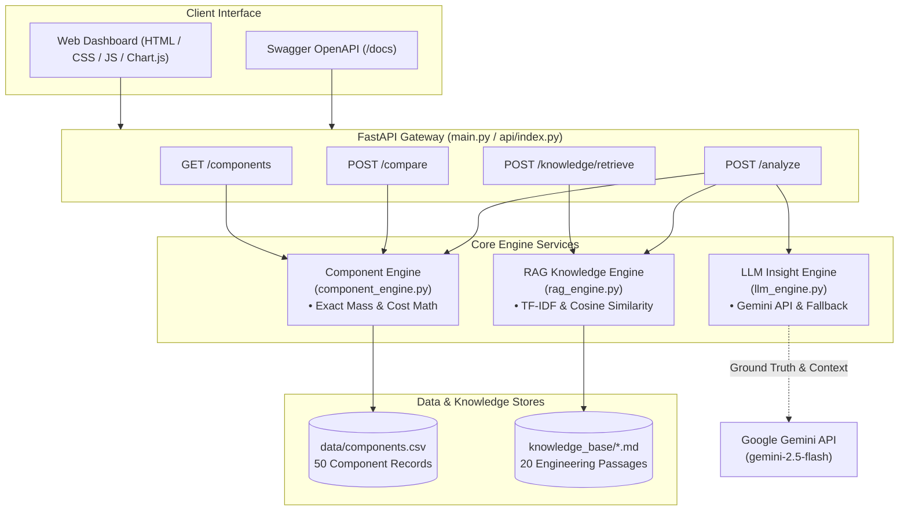

# COMPBENCH AI

**Automotive Component Benchmarking & Engineering Intelligence**

[](https://www.python.org/)
[](https://fastapi.tiangolo.com)
[](https://scikit-learn.org/)
[](https://ai.google.dev/)
[](https://vercel.com)
[](LICENSE)

---

## 1. Project Overview

**CompBench AI** is an engineering benchmarking and decision-support platform designed for automotive systems engineers, cost engineers, and vehicle architects. It analyzes structural material substitutions (such as transitioning from stamped mild steel to cast aluminum or engineered composites) and manufacturing processes across automotive subsystems.

The platform combines three core engineering pillars:
1. **Deterministic Python Calculations**: Exact, auditable numerical deltas for component mass ($\Delta\text{kg}$), weight reduction ($\%$), unit cost variance ($\Delta\text{USD}$), and economic cost-efficiency ($\$/\text{kg}$ saved).
2. **Domain-Specific RAG Knowledge Retrieval**: Information retrieval over curated automotive engineering reference literature utilizing scikit-learn TF-IDF vectorization and cosine similarity.
3. **Generative AI Teardown Explanations**: Synthesis of structured engineering teardown reports using the Google Gemini API (`google-genai` SDK), constrained strictly to ground-truth numerical calculations with an automated deterministic fallback.

---

## 2. System Architecture



---

## 3. Key Features

- **Fleet Overview & KPI Analytics**: Real-time fleet metrics showing total component records (50), material categories (5), average component weight, and data fidelity indicators.
- **Side-by-Side Component Benchmarking**: Dynamic dropdown selection grouped by automotive subsystem with part filtering and instantaneous preview.
- **Visual Analytics**: Interactive mass ($\text{kg}$) and cost ($\text{USD}$) comparison charts rendered dynamically with Chart.js.
- **Domain RAG Engine**: Specialized retrieval engine querying 5 core automotive domains without external vector database dependencies:
  - Steel vs. Aluminum comparisons
  - Material weight and cost trade-offs ($\$/\text{kg}$ saved)
  - Manufacturing processes (Stamping, HPDC Megacasting, Injection Molding, Forging)
  - Vehicle lightweighting and battery packaging considerations
  - Material selection factors (strength, durability, corrosion, manufacturability, cost)
- **Structured 8-Section AI Teardown Reports**:
  1. Comparison Summary
  2. Weight Reduction Analysis
  3. Cost Trade-Off Analysis
  4. Material and Manufacturing Process Differences
  5. Engineering Considerations
  6. Potential Advantages
  7. Risks and Limitations
  8. Final Engineering Recommendation
- **Zero-Crash Graceful Fallback**: If the Gemini API key is absent or quota-limited, the system generates a deterministic engineering report using exact calculations and RAG passages.
- **Ground Truth Preservation**: Explicit prompt constraints prevent the LLM from inventing, re-rounding, or modifying Python-calculated metrics.

---

## 4. Technology Stack

| Layer | Technologies |
| :--- | :--- |
| **Backend Framework** | [FastAPI](https://fastapi.tiangolo.com/), [Starlette](https://www.starlette.io/), [Uvicorn](https://www.uvicorn.org/) |
| **Data & Validation** | [Pandas](https://pandas.pydata.org/), [Pydantic v2](https://docs.pydantic.dev/) |
| **Machine Learning & RAG**| [Scikit-learn](https://scikit-learn.org/) (TF-IDF Vectorizer, Cosine Similarity) |
| **Large Language Models** | [Google Gemini API](https://ai.google.dev/) via official `google-genai` SDK |
| **Frontend UI** | HTML5, Modern Industrial CSS3 (Dark Navy theme), Vanilla ES6+ JavaScript |
| **Data Visualization** | [Chart.js 4.4](https://www.chartjs.org/) (CDN delivery) |
| **Environment & Config** | [python-dotenv](https://github.com/theskumar/python-dotenv) |
| **Deployment** | [Vercel](https://vercel.com/) Serverless ASGI (`api/index.py`, `vercel.json`), Linux/Docker compatible |

---

## 5. Project Directory Structure

```
CompBenchAI/
├── data/
│   └── components.csv               # 50 synthetic automotive component records
├── frontend/
│   ├── index.html                   # Industrial engineering dashboard UI
│   ├── style.css                    # Dark navy theme stylesheet
│   └── app.js                       # Frontend state, API integration & Chart.js logic
├── knowledge_base/
│   ├── steel_vs_aluminum.md          # Physical, mechanical & joining comparisons
│   ├── material_tradeoffs.md         # $/kg saved and secondary mass compounding
│   ├── manufacturing_processes.md    # Stamping, HPDC casting, molding, forging
│   ├── lightweighting_considerations.md # EV range drivers, multi-material BIW
│   └── material_selection_factors.md # Strength, durability, fatigue, corrosion
├── services/
│   ├── component_engine.py          # Component loading and deterministic comparison
│   ├── rag_engine.py                # TF-IDF knowledge base loader & retrieval
│   └── llm_engine.py                # Gemini API integration & deterministic fallback
├── .env.example                     # Environment configuration template
├── .gitignore                       # Git exclusion rules (keys, virtualenvs, cache)
├── .vercelignore                     # Vercel packaging exclusion rules
├── main.py                          # FastAPI application routing & static file serving
├── requirements.txt                 # Production dependencies
├── test_engine.py                   # Component engine unit test
├── test_rag.py                      # RAG retrieval unit and integration tests
├── test_llm.py                      # LLM fallback and full API endpoint suite
└── test_frontend_server.py          # Static file and HTTP serving verification
```

---

## 6. Setup & Installation

### Prerequisites
- Python 3.11, 3.12, or 3.14
- Git

### 1. Clone the Repository
```bash
git clone https://github.com/your-username/compbench-ai.git
cd compbench-ai
```

### 2. Create and Activate Virtual Environment
```bash
# macOS / Linux
python3 -m venv venv
source venv/bin/activate

# Windows (PowerShell)
python -m venv venv
.\venv\Scripts\Activate.ps1
```

### 3. Install Dependencies
```bash
pip install --upgrade pip
pip install -r requirements.txt
```

### 4. Configure Environment Variables
Copy the `.env.example` template to `.env`:
```bash
# macOS / Linux
cp .env.example .env

# Windows (PowerShell)
Copy-Item .env.example .env
```

Open `.env` and configure your Google Gemini API key:
```ini
GEMINI_API_KEY=AIzaSy...your_actual_api_key_here
GEMINI_MODEL=gemini-2.5-flash
```
*(You can obtain a free API key at [Google AI Studio](https://aistudio.google.com/). If unconfigured, the application runs normally using the deterministic engineering fallback report).*

### 5. Launch the Application
```bash
uvicorn main:app --reload --host 127.0.0.1 --port 8000
```

- **Interactive Dashboard**: Open [http://127.0.0.1:8000](http://127.0.0.1:8000) in your browser.
- **Swagger API Docs**: Open [http://127.0.0.1:8000/docs](http://127.0.0.1:8000/docs).

---

## 7. API Endpoints Reference

| Method | Endpoint | Description | Request Payload | Response |
| :--- | :--- | :--- | :--- | :--- |
| `GET` | `/` | Web Dashboard (browser) or API Status (JSON) | None | HTML or JSON |
| `GET` | `/dashboard` | Explicit dashboard route | None | HTML FileResponse |
| `GET` | `/components` | Returns all 50 component records | None | Array of component records |
| `POST` | `/compare` | Deterministic benchmark calculation | `{"component_a_id": "CB001", "component_b_id": "CB002"}` | Component specs & variance |
| `POST` | `/knowledge/retrieve` | Semantic RAG knowledge search | `{"query": "Steel vs Aluminum door panel", "top_k": 3}` | Ranked knowledge passages |
| `POST` | `/analyze` | End-to-end comparison + RAG + AI report | `{"component_a_id": "CB001", "component_b_id": "CB002", "top_k": 3}` | Full report, metrics & sources |

---

## 8. Dashboard Preview

```
+-----------------------------------------------------------------------------------------------+
|  COMPBENCH AI   [ENGINEERING SUITE]   FastAPI: Active  |  Dataset: Synthetic Demo (50 Records)|
+-----------------------------------------------------------------------------------------------+
|  TOTAL COMPONENTS     MATERIAL CATEGORIES     AVG COMPONENT WEIGHT     DATA INTEGRITY         |
|  [ 50 Parts ]         [ 5 Materials ]         [ 2.94 kg ]              [ Synthetic Demo ]     |
+-----------------------------------------------------------------------------------------------+
|  COMPONENT BENCHMARKING CONSOLE                                                               |
|  Filter Part: [ All ] [ Door Panel ] [ Control Arm ] [ Dashboard Frame ]                      |
|                                                                                               |
|  Baseline: Component A        < -- [ Swap ] -- >        Comparison: Component B               |
|  [CB001] Door Panel - Steel                             [CB002] Door Panel - Aluminum         |
|  Weight: 3.50 kg | Cost: $850.00                        Weight: 2.27 kg | Cost: $1,062.50     |
|                                                                                               |
|                     [ Run Benchmark Comparison ]    [ Generate AI Engineering Insight ]       |
+-----------------------------------------------------------------------------------------------+
|  BENCHMARK ANALYTICS                                                                          |
|  Weight Difference: -1.23 kg (-35.14%)  |  Cost Difference: +$212.50 (+25.00%)                |
|  Material Shift: Steel -> Aluminum      |  Process Shift: Stamping -> Casting                 |
|                                                                                               |
|  [ Mass Benchmark Bar Chart ]           |  [ Total Cost Benchmark Bar Chart ]                 |
+-----------------------------------------------------------------------------------------------+
|  AI ENGINEERING INTELLIGENCE REPORT                    [ Gemini Live AI / Fallback Engine ]   |
|  [1. Comparison Summary]                [2. Weight Reduction Analysis]                        |
|  [3. Cost Trade-Off Analysis]           [4. Material & Process Differences]                   |
|  [5. Engineering Considerations]        [6. Potential Advantages]                             |
|  [7. Risks & Limitations]               [8. Final Engineering Recommendation]                 |
|                                                                                               |
|  RAG CONTEXT REFERENCES:                                                                      |
|  * Steel vs. Aluminum in Automotive Engineering (2. Cost and Economic Trade-offs)             |
|  * Steel vs. Aluminum in Automotive Engineering (5. Applications in Door Panels)              |
+-----------------------------------------------------------------------------------------------+
```

---

## 9. Deployment Guide

### Vercel Deployment (Zero-Config Native FastAPI)
1. Push your repository to GitHub.
2. In the [Vercel Dashboard](https://vercel.com/new), click **Import** on your `CompBenchAI` repository.
3. Vercel automatically detects the **FastAPI preset** (`main.py:app`), automatically mounts static assets in `frontend/` to the Vercel Edge CDN, and runs the application without requiring custom rewrites or an `api/` directory.
4. In **Project Settings** &rarr; **Environment Variables**, add:
   - `GEMINI_API_KEY`: Your Google Gemini API Key
   - `GEMINI_MODEL`: `gemini-2.5-flash` *(optional)*
5. Click **Deploy**. Vercel will install dependencies from `requirements.txt` and provide a production HTTPS URL.

### Linux / Docker Deployment
To run on a Linux server or container:
```bash
gunicorn -w 4 -k uvicorn.workers.UvicornWorker main:app --bind 0.0.0.0:8000
```

---

## 10. Engineering Transparency & Limitations

1. **Synthetic Dataset**: All 50 component records in `data/components.csv` were generated for demonstration and educational benchmarking. They do not represent proprietary or confidential data from any specific automotive OEM.
2. **Educational Reference Material**: The documents in `knowledge_base/` are synthesized from general engineering domain literature and public academic principles. They do not represent proprietary Caresoft teardown data or confidential OEM design rules.
3. **Non-Certified Recommendations**: AI-generated explanations and benchmark trade-off analyses are intended for academic exploration and preliminary trade study orientation. They do not replace certified vehicle safety sign-offs, crash simulation (CAE/FEA), or official bill-of-materials (BOM) cost accounting.

---

## 11. Testing & Quality Assurance

Run all test suites locally:
```bash
# 1. Test Component Comparison Math
python test_engine.py

# 2. Test RAG Knowledge Base Retrieval
python test_rag.py

# 3. Test LLM Engine, Fallback & API Endpoints
python test_llm.py

# 4. Test Frontend Server & Static Assets
python test_frontend_server.py
```
